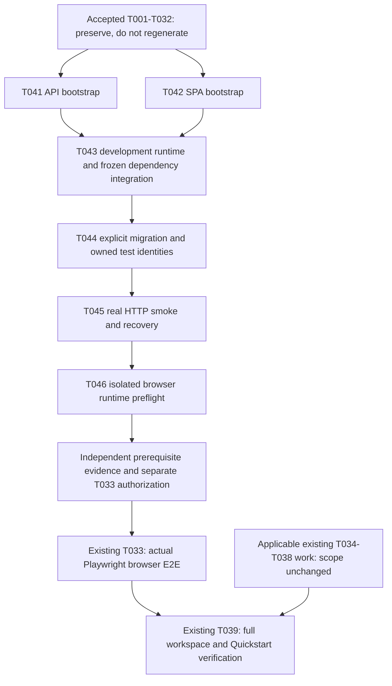

# Tasks: Feature 001 — application-foundation

## Phase 1: Setup
**Purpose**: Project initialization, exact dependency baselines, and development environment.

- [ ] T001 Initialize pnpm 12.9.1 workspace with `pnpm-workspace.yaml` and root `package.json` specifying exact Node.js 24.21.0 version.
- [ ] T002 [P] Create `packages/db/package.json` configuring exact TypeScript 6.0.3, Kysely 0.29.6, and pg 8.23.1.
- [ ] T003 [P] Create `apps/api/package.json` configuring exact Fastify 5.12.5, Zod 4.6.5, `@fastify/type-provider-zod` 1.0.0, `@fastify/swagger` 9.9.1, TypeScript 6.0.3, and Vitest 5.0.3.
- [ ] T004 [P] Create `apps/web/package.json` configuring exact React 19.3.0, Vite 8.3.3, React Router 7.18.4, and TypeScript 6.0.3.
- [ ] T005 [P] Create `deploy/podman/compose.yaml` (Compose Spec) defining `api`, `web`, and a private `postgres:18.6-alpine` database network with a named volume (`postgres-data`). Configure `userns=keep-id` for host mounts.
- [ ] T006 Implement deterministic Compose provider preflight script in `scripts/dev.sh` ensuring `export PODMAN_COMPOSE_PROVIDER=podman-compose` is set and execution fails closed non-zero if `podman-compose 1.6.0` is absent.

---

## Phase 2: Foundational blockers
**Purpose**: Blocking prerequisites including configuration, migrations, error handling, and test harness setup.
**⚠️ CRITICAL**: No user story work can begin until this phase is complete.

- [ ] T007 Implement Kysely explicit migration runner/CLI script in `packages/db/src/migrator.ts`.
- [ ] T008 Create database migration `packages/db/src/migrations/0001_foundation.ts` for users (`id`: UUID Primary Key, `username`: String Unique canonical login identifier, `password_hash`: String Argon2id, `is_active`: Boolean Default true, `created_at`: Timestamp, `updated_at`: Timestamp), sessions (`id`: String SHA-256 Digest of Secure Opaque Token, `user_id`: UUID Foreign Key to `users`, `expires_at`: Timestamp, `created_at`: Timestamp), roles (`id`: String Primary Key explicit identifier e.g., 'ADMINISTRATOR', 'SYSTEM_MAINTAINER', `description`: String), and user_roles (`user_id`: UUID Foreign Key, `role_id`: String Foreign Key).
- [ ] T009 Implement integration test in `apps/api/tests/integration/db.test.ts` to verify migrations apply successfully to a clean real PostgreSQL database.
- [ ] T010 Create unit tests in `apps/api/tests/unit/config.test.ts` verifying missing required configuration is rejected, malformed required configuration is rejected, and the application cannot enter the ready operational path with invalid configuration.
- [ ] T011 Implement Zod-based config loader in `apps/api/src/config/env.ts` that fails closed immediately on missing or malformed required configuration.
- [ ] T012 Create unit tests in `apps/api/tests/unit/logger.test.ts` verifying configured secret fields are redacted and raw secrets do not appear in emitted operational logs.
- [ ] T013 Implement Pino logger with secrets redaction in `apps/api/src/plugins/logger.ts`.
- [ ] T014 Create unit tests in `apps/api/tests/unit/error-handler.test.ts` verifying deterministic machine-readable error code, safe user-facing message, request/correlation ID, minimized validation details, no stack trace leakage, no query/internal implementation leakage, and no secret leakage.
- [ ] T015 Implement standard Fastify error handler conforming exactly to `api-error.md` in `apps/api/src/plugins/error-handler.ts`.

**Checkpoint**: Foundation ready - user story implementation can now begin.

---

## Phase 3: User Story 1 - Session Establishment and Lifecycle (Priority: P1) 🎯 MVP
**Goal**: The system must establish secure sessions using local credentials and deny access on expiration/revocation.
**Independent Test**: Can be tested by logging in via API, receiving a cookie, using it for a subsequent request, and observing rejection after logout.

### Tests for User Story 1
- [ ] T016 [US1] Create integration tests in `apps/api/tests/integration/auth.test.ts` for valid local login, invalid credentials, disabled user, session expiry, session revocation, secure cookie attributes, and CSRF behavior.

### Implementation for User Story 1
- [ ] T017 [US1] Install `argon2` 0.45.1, `@fastify/cookie` 11.1.2, and `@fastify/csrf-protection` 8.0.1 in `apps/api/package.json`.
- [ ] T018 [P] [US1] Implement `UserService` in `apps/api/src/services/user.service.ts` using Argon2id for password hashing and verification.
- [ ] T019 [P] [US1] Implement `SessionService` in `apps/api/src/services/session.service.ts` to generate raw opaque tokens, store ONLY the SHA-256 digest in the database, and enforce an 8-hour expiry.
- [ ] T020 [US1] Implement Fastify Auth plugin in `apps/api/src/plugins/auth.ts` verifying session digests and enforcing `SameSite=Lax`, `HttpOnly`, and `Secure` cookies.
- [ ] T021 [US1] Implement token-based CSRF protection middleware for state-changing requests in `apps/api/src/plugins/csrf.ts`.
- [ ] T022 [US1] Implement Auth REST endpoints (login, logout, session-check) in `apps/api/src/routes/auth.routes.ts`.

---

## Phase 4: User Story 2 - Capability Enforcement (Priority: P1)
**Goal**: The system must enforce server-side authorization mapping roles to capabilities dynamically per request.
**Independent Test**: Assign a capability to a user and observe successful access, then revoke the role and observe immediate rejection on the next protected request.

### Tests for User Story 2
- [ ] T023 [US2] Create integration tests in `apps/api/tests/integration/authorization.test.ts` verifying unauthenticated access is denied, authenticated without capability is denied, authenticated with capability is allowed, and capability revocation is effective on the next request.

### Implementation for User Story 2
- [ ] T024 [P] [US2] Implement code-defined capability mapping logic in `apps/api/src/services/capability.service.ts` to dynamically resolve current roles to capabilities without caching in session.
- [ ] T025 [US2] Implement authorization middleware in `apps/api/src/middleware/authorization.ts` to enforce capabilities authoritatively on protected routes.
- [ ] T026 [US2] Apply authorization middleware to a protected route in `apps/api/src/routes/system.routes.ts` verifying enforcement.

---

## Phase 5: User Story 3 - Traceable Audit and Error Handling (Priority: P2)
**Goal**: Record audit history securely within transaction boundaries and handle missing dependencies/errors safely.
**Independent Test**: Trigger an API action to verify `AuditContext` records, and sever database connectivity to verify `/ready` fail-closed behavior.

### Tests for User Story 3
- [ ] T027 [US3] Create integration tests in `apps/api/tests/integration/transaction.test.ts` using independent real PostgreSQL connections to explicitly prove the accepted foundation behavior using native Kysely transaction APIs directly. Must execute at least two writes inside a native transaction, deliberately fail after an intermediate write, prove no partial committed state remains, and not use an outer rollback harness that masks production semantics.
- [ ] T028 [US3] Create integration tests in `apps/api/tests/integration/health.test.ts` verifying database unavailability causes `/ready` failure and safe operation failure.

### Implementation for User Story 3
- [ ] T029 [P] [US3] Define `AuditContext` explicit type (`actor`, `action`, `recorded_at`) in `apps/api/src/types/audit-context.ts`.
- [ ] T030 [US3] Implement `/health` (liveness) and `/ready` (gates on PostgreSQL connectivity) endpoints in `apps/api/src/routes/health.routes.ts`.

---

## Phase 6: User Story 4 - Reproducible Development Environment (Priority: P2)
**Goal**: Web frontend implementation and isolated testing of the end-to-end foundation.
**Independent Test**: Run a browser-based E2E authentication flow in an isolated Playwright container.

### Implementation for User Story 4
- [ ] T031 [P] [US4] Implement minimum web UI for login, protected dashboard, and CSRF token handling in `apps/web/src/pages/Login.tsx` and `apps/web/src/pages/Dashboard.tsx`.
- [ ] T032 [P] [US4] Configure Playwright 1.63.0 E2E test setup in `apps/web/playwright.config.ts`.
- [x] T033 [US4] Implement minimum authentication/session Playwright E2E test in `apps/web/tests/e2e/auth.spec.ts` executing inside an isolated Playwright container boundary (`mcr.microsoft.com/playwright:v1.63.0-noble`).

---

## Phase 7: Polish & Cross-Cutting Concerns
**Purpose**: Final verification, CI, backup semantics, and Quadlet production artifacts.

- [x] T034 [P] Create `scripts/backup.sh` defining non-interactive logical backup without a pseudo-TTY (`podman exec <postgres-container> pg_dump -F c`).
- [ ] T035 [P] Create `scripts/restore.sh` defining restore verification against an isolated test database (`podman exec -i <postgres-container> pg_restore`).
- [ ] T036 [P] Create `deploy/podman/api.Containerfile` for the API OCI image using Node.js 24.21.0.
- [ ] T037 [P] Create production Quadlet definitions `api.container`, `api-migration.container` (one-shot migration responsibility that executes explicit migration command, depends on PostgreSQL, and runs before API service rollout/start without causing API auto-migration), `postgres.container`, `postgres-data.volume`, `s2-assets.network` in `deploy/podman/quadlet/`.
- [ ] T038 Create explicit CI pipeline in `.github/workflows/ci.yml` verifying frozen dependency installation, workspace lint, typecheck, unit tests, real PostgreSQL integration tests, web/API production build, Playwright E2E, and Trivy scan.
- [ ] T039 Perform full workspace verification confirming Feature 001 produces the tested static web production artifact and that the Quickstart operates correctly.
- [ ] T040 Perform explicit boundary verification reviewing the implemented Feature 001 diff against FR-007, SC-005, and Constitution Feature-Bounded Delivery principle, verifying implementation contains no generic transaction framework, no generic audit platform, no event sourcing/event bus, no generic workflow engine, no enterprise IAM/RBAC framework, no speculative shared-services layer, no Asset/Material domain implementation, and no reverse-proxy product selection.

---

## Traceability Summary
- **FR-001**: T016-T022
- **FR-002**: T023-T026
- **FR-003**: T029
- **FR-004**: T010, T011, T012, T013
- **FR-012**: T028, T030
- **FR-005**: T005, T006, T036, T037
- **FR-006**: T009, T027, T038
- **FR-007/SC-005**: T040 explicit final boundary verification
- **FR-008**: Verified through explicit constraint mappings in T008 and T027
- **FR-009**: T025, T026
- **FR-010**: T027 native Kysely transaction verification
- **FR-011**: T014, T015
- **SC-001**: T023, T026
- **SC-002**: T005, T006, T039
- **SC-003**: T027, T038
- **SC-004**: T029
- **Production Migration Responsibility**: T037

---

## Phase 8: User Story 4 — Runnable Foundation Reconciliation (Priority: P2)

**Status**: Documentation-only candidate generated with `$speckit-tasks`; independent review and Human Gate pending. This section authorizes no implementation or test execution.

**Input**: Existing [specification](./spec.md), merged [Plan](./plan.md) at `5f2b2a69078c0ef383620019af08470e9b6adf8c`, [research](./research.md), [Quickstart](./quickstart.md), unchanged [data model](./data-model.md) and [error contract](./contracts/api-error.md). Draft PR #7 is not authority.

**Preservation**: Everything above this section is retained byte-for-byte, including T001–T040 descriptions, checkboxes, phases and mappings. T001–T032 were accepted; their historical unchecked boxes do not reopen or regenerate them. T033 remains the sole browser E2E task. T034–T040 retain their scope and separate authorization. Phase 8 is appended to preserve history; its prerequisites execute **before T033**, not after Phase 7. This explicit dependency order governs the additions.

**Goal**: Connect the accepted US1/US2/US3 primitives and US4 pages/configuration into a reproducible Rootless Podman application, without reimplementing those features.

**Independent test**: On a dedicated project/database, prepare pinned container tooling, explicitly migrate, prepare owned test identities, start real API/Web processes, prove HTTP security/dependency behavior and clean up owned fixtures. Browser runner readiness is checked separately; only T033 proves the actual Chromium flow. All runtime/application checks below occur only during later explicitly authorized implementation, never during this documentation reconciliation.

### Application bootstrap — independent scopes

- [ ] T041 [P] [US4] Compose the accepted API in `apps/api/src/app.ts` and `apps/api/src/server.ts`, with development/typecheck/build/start commands in `apps/api/package.json`, bounded TypeScript build configuration under `apps/api/`, and focused startup/composition verification in `apps/api/tests/unit/app.test.ts`.

  **Prerequisites**: Accepted T001–T030 modules/configuration and subsequent bounded implementation authorization. No dependency on T042. **Scope**: Validate configuration before listening; factory construction must not listen. Share one owned PostgreSQL pool, preserve injected-client ownership, and release resources on startup failure/SIGTERM/SIGINT. Register the accepted redacted logger/error handling, cookie/CSRF integration, auth and routes in effective application scope and safe signing order. Mount auth once at `/auth`, system once at `/system`, and public `/health`/`/ready` at root; all other unmarked routes remain authenticated and `/system/info` enforces `system:maintain`. Do not expose test-only CSRF routes or broaden exemptions. Supply `dev`, `start:dev`, `typecheck`, `build` and `start`; emitted ESM must handle existing TS imports correctly. Preserve existing dependency/security decisions and tests.

  **Completion**: Focused checks prove route/plugin composition, invalid configuration aborts the actual non-watching entrypoint before an operational listener without secret leakage, and ownership/shutdown behavior is correct; declared scripts typecheck/build/run in a disposable approved Node container. T043 owns final integrated lockfile/frozen-install acceptance; T045 owns real-stack HTTP proof. **Traceability**: FR-001, FR-002, FR-004, FR-009, FR-011, FR-012, SC-001, SC-002; US4/AC1 integrating existing P1 security.

- [x] T042 [P] [US4] Bootstrap the existing SPA through `apps/web/index.html`, `apps/web/src/main.tsx`, `apps/web/src/router.tsx`, `apps/web/vite.config.ts`, `apps/web/tsconfig.json` and `apps/web/package.json`, reusing `apps/web/src/pages/Login.tsx` and `apps/web/src/pages/Dashboard.tsx` unchanged in behavior.

  **Prerequisites**: Accepted T001/T004/T031 and subsequent bounded implementation authorization. No dependency on T041. **Scope**: Use React DOM and React Router 7 Data mode; `/` redirects to `/login`, and `/login`/`/dashboard` support direct navigation/reload. Preserve session checking, relative fetches, cookies and CSRF handling. Supply `dev`, `typecheck`, `build`, matching `react-dom:19.3.0` and only necessary exact compatible declaration pins without changing existing pins. Vite binds `0.0.0.0:5173`, uses strict port selection and an explicit `web` host allowlist, and development-only proxies `/auth` and `/system` unchanged to `http://api:3000`. No SSR/Framework mode, CORS layer or production proxy selection.

  **Completion**: The SPA typechecks/builds in a disposable approved container; the entrypoint/router renders the accepted pages and direct routes serve the SPA. Record exact added dependency pins for T043; integrated frozen install and backend connectivity remain T043/T045 gates. Do not create or run T033's browser test. **Traceability**: FR-001, FR-005, FR-009, SC-001, SC-002; US4/AC1.

### Development runtime and explicit initialization

- [x] T043 [US4] Implement container-only development preparation and executable services in `deploy/podman/dev.Containerfile`, `deploy/podman/compose.yaml` and `scripts/dev.sh`, integrate the approved bootstrap manifests into `pnpm-lock.yaml`, and reconcile the environment/preparation/startup instructions in `specs/001-application-foundation/quickstart.md` only as necessary to match verified commands.

  **Prerequisites**: T041 and T042 candidates integrated, accepted T005/T006, and bounded implementation authorization. **Scope**: Provision exact Node `24.21.0`, pnpm `12.9.1` and the existing runtime/database pins, including native dependency support. Preserve no-argument/source provider preflight and add only the planned fixed-purpose `prepare` action; reject unknown actions and propagate failures. T043 is the sole shared lockfile integration owner for T041/T042's necessary exact manifest pins. Install once before concurrent services; subsequent `pnpm install --frozen-lockfile` must neither resolve new versions nor rewrite the lockfile. Compose API/Web execute their `dev` scripts as foreground processes. Keep PostgreSQL unpublished on its private network, API on both networks, explicit project/network/volume ownership, writable `keep-id` storage, Fedora SELinux-safe shared mounts and loopback-only configurable application ports. Use the same explicit Compose file/project/private environment file throughout; reject absent/default secrets and occupied ports rather than silently choosing alternatives. Do not couple app code to Podman, mount its socket into API/Web, auto-migrate, or modify T036's production image scope.

  **Completion**: Record pinned tooling and frozen-install success, real API/Web reachability, container-to-private-PostgreSQL connectivity, source-mount ownership, and the selected image's effective data-directory volume mapping on a unique test-owned project. Invalid preparation/configuration fails nonzero without secret leakage. Runtime teardown targets that project and preserves its data volume. Schema creation and persistence after migration are T044's explicit gate. **Traceability**: FR-004, FR-005, SC-002; US4/AC1.

- [x] T044 [US4] Wire explicit development migration and disposable fixture setup/cleanup through `scripts/dev.sh` and `apps/api/tests/fixtures/identity.ts`, add only necessary fixture command wiring in `apps/api/package.json`, verify isolation in `apps/api/tests/unit/identity-fixture.test.ts`, and align the initialization/cleanup sections of `specs/001-application-foundation/quickstart.md`.

  **Prerequisites**: T043; accepted T007–T009, T018/T019 and T024; bounded implementation authorization. **Scope**: Reuse the unchanged `packages/db/src/migrator.ts`, foundation schema and existing root `db:migrate`/`db:migrate:down` commands. Enforce PostgreSQL availability → explicit one-shot migration → fixture setup when testing → dependent application verification. Never auto-migrate/seed on app startup or redefine connectivity-only `/ready` as a schema check. `test-identity setup|cleanup` runs inside a short-lived container with `NODE_ENV=test`, unique `FOUNDATION_TEST_RUN_ID`, and `FOUNDATION_TEST_DATABASE_URL` matching the explicitly selected `s2_foundation_...` database. Reject production, missing/unmarked/mismatched targets and conflicting preexisting identities. Create only run-owned active maintainer/non-capable identities with accepted Argon2id and role semantics; no schema change or production account provisioning. Keep credentials/cookies/tokens/ownership state in a mode-restricted runtime directory outside checkout/images and out of argument literals/logs. Record exact created rows; cleanup removes only owned sessions/grants/users while preserving the shared SYSTEM_MAINTAINER role even when unused, including partial-failure cleanup without masking the original failure.

  **Completion**: On a clean dedicated database, explicit migration succeeds and repetition has no pending work; foundation schema persists across normal project down/up. Fixture login works; negative target/isolation checks reject unsafe setup; repeated/partial-failure cleanup is safe and leaves preexisting rows untouched. Preserve original transaction/integration semantics and never reset a shared database. **Traceability**: FR-001, FR-004, FR-005, FR-008, SC-002; US4/AC1/AC2.

### Actual HTTP proof and browser runtime readiness

- [x] T045 [US4] Implement real listening-application verification in `apps/api/tests/http/foundation.test.ts`, expose `test:http` in `apps/api/package.json` and the planned `http-smoke` action in `scripts/dev.sh`, and record executable smoke commands/expected results in `specs/001-application-foundation/quickstart.md`.

  **Prerequisites**: T044 and all its transitive bootstrap/runtime prerequisites; bounded implementation authorization. **Scope**: Exercise actual entrypoint/API/Web processes from a container using `HTTP_API_URL=http://api:3000` and `HTTP_WEB_URL=http://web:5173`. Prove invalid required configuration cannot serve operational requests; safe public probes and errors; unauthenticated 401; insufficient-capability 403; authorized `/system/info`; immediate capability revocation; valid/invalid login; session-check; missing/invalid CSRF rejection; valid logout and subsequent session rejection. Verify SPA direct routes and proxy cookie/CSRF forwarding. Only the host helper may interrupt the exactly identified PostgreSQL service of the dedicated test project: `/health` remains live, `/ready` is 503 and DB-dependent operations cannot succeed; restore dependency and verify recovery. Restore deliberately changed fixture state or provision fresh owned identities before subsequent checks.

  **Completion**: Record exact non-secret commands, statuses and assertions from the real listening stack, successful recovery, and bounded cleanup on success/failure with failure exit preservation. `/health` and successful `/ready` return the accepted `{"status":"ok"}`; explicit migration plus authenticated operations separately prove schema initialization. Mocks, `inject`, fallback test apps, route discovery and discovery-only output cannot satisfy this gate. Retain existing tests; do not claim browser E2E success. **Traceability**: FR-001, FR-002, FR-004, FR-005, FR-009, FR-011, FR-012, SC-001, SC-002; US4/AC1 integrating existing security/dependency requirements.

- [x] T046 [US4] Verify isolated Playwright runtime readiness using directly invoked Podman, pnpm, Playwright/Chromium and HTTP commands from Fedora; record the runbook and acceptance evidence in `specs/001-application-foundation/quickstart.md`.

  **Prerequisites**: Accepted T032, T045 real HTTP evidence, the verified existing `s2-assets-dev` PostgreSQL/API/Web Development Runtime and `s2-assets-dev-app` network, verified existing offline dependencies and separate Product Owner execution authorization. **Scope**: Retain Node `24.21.0`, pnpm `12.9.1`, Playwright `1.63.0` and the corresponding Chromium from `mcr.microsoft.com/playwright:v1.63.0-noble`, using the verified pre-provisioned runner. Install offline with the frozen lockfile only in a disposable workspace. Use direct standard commands; no new helper, controller, protocol, ledger or framework. Verify the existing Web command/configuration as data, Chromium availability and actual runner-to-Web HTTP connectivity at exactly `http://web:5173`. Reuse persistent `s2-assets-dev` for non-destructive readiness; remove only temporary runner-owned resources. Do not stop, restart, recreate or modify Development services/database contents, run migrations/fixtures/outage tests, or provision another application stack. No image build/pull, network provisioning, application change or browser E2E execution.

  **Completion**: Record exact image/tool/browser versions, successful offline frozen installation, unchanged lockfile, Web command/configuration identity, HTTP 200 HTML from `/` and `/login`, confirmed runner absence and unchanged persistent resource IDs/start times/restart counts. Any failed, missing, interrupted or uncertain check prevents PASS, including cleanup failure. Readiness is not browser E2E acceptance: T033 remains unchecked and separately requires actual Chromium authentication/session/direct-navigation tests and existing failure diagnostics. **Traceability**: FR-001, FR-005, SC-002; US4/AC1 and existing T033 prerequisites. This bounded task supersedes the planned T046 `e2e` helper contract in the plan/research under [Product Owner direction, 2026-10-18](https://github.com/9GotStory/s2-assets/pull/10#issuecomment-6247686905); PR #10 remains blocked historical evidence.

### Dependencies and T033 prerequisite gate

Before T033, require completion and independent verification of **T041–T046**, successful explicit migration and safe fixture lifecycle, actual HTTP security/recovery evidence, and the pinned browser runtime's network/configuration readiness. A task document, an image pull or a preflight exit alone cannot satisfy the complete gate. T033's existing test path and browser acceptance remain unchanged; T039 still proves complete workspace/Quickstart/build behavior after T033 and applicable existing Phase 7 work. T040 retains its final boundary review. None of these gate descriptions marks any task accepted or authorizes the next step.

### Parallel opportunities and incremental strategy

T041 and T042 may run independently after their accepted prerequisites: API-owned files versus Web-owned files. They do not edit `scripts/dev.sh` or `pnpm-lock.yaml`; T043 integrates their exact dependency manifests and is the sole shared lockfile writer. If an isolated bootstrap validation needs dependency resolution, use a disposable container workspace, retain exact pin evidence, and leave integrated frozen-install acceptance to T043. T043–T046 share helper/Quickstart files and therefore run sequentially, not with `[P]` markers.

The smallest useful new increment is T041/T042 composition, followed by reproducible initialized runtime at T043/T044. T045 proves the listening application's existing invariants; T046 prepares the existing browser task. Keep US1/US2/US3's accepted behavior and verification; do not start another feature, replace those stories, add speculative frameworks or treat this bootstrap increment as final Feature 001 acceptance. Each later execution needs bounded authorization and evidence; this task-generation pass stops at Human Gate.

### Additive requirements-to-tasks coverage

The original Traceability Summary above remains intact. This supplement connects missing executable prerequisites to the same requirements; it does not replace accepted mappings or expand original task scope.

| Requirement / story | Retained tasks | Additional executable coverage |
|---|---|---|
| FR-001 | T016–T022 | T041, T042, T044, T045; T046 prepares existing T033 |
| FR-002 | T023–T026 | T041, T045 application-level capability checks |
| FR-003 | T029 | Unchanged audit primitive; no new audit platform task |
| FR-004 | T010–T013 | T041, T043, T044, T045 initialization/secret boundaries |
| FR-005 | T005, T006, T036, T037 | T042–T046 plus T041's executable API |
| FR-006 | T009, T027, T038 | Existing real-PostgreSQL verification retained; HTTP smoke does not replace it |
| FR-007 | T040 | Same explicit boundary review; no replacement framework work |
| FR-008 | T008, T027 | T044 test-owned identity isolation without fabricated business data |
| FR-009 | T025, T026 | T041, T042, T045 server authority on actual routes/deep links |
| FR-010 | T027 | Native transaction verification remains unchanged |
| FR-011 | T014, T015 | T041, T045 accepted safe errors in actual application |
| FR-012 | T028, T030 | T041, T045 connectivity/dependency failure and recovery |
| SC-001 | T023, T026 | T041, T045 actual protected-route enforcement |
| SC-002 | T005, T006, T039 | T041–T046; T033 remains actual browser verification |
| SC-003 | T027, T038 | Real-database transaction/CI obligations remain unchanged |
| SC-004 | T029 | Accepted audit context unchanged |
| SC-005 | T040 | Existing final boundary verification unchanged |
| US4 / AC1 | T005, T006, T031–T033, T039 | T041–T046 connect pages/modules to runnable three-service stack |
| US4 / AC2 | T009, T027, T038 | T043/T044 supply initialized isolated runtime; original PostgreSQL invariant tests remain mandatory |
| Production migration responsibility | T037 | Unchanged; T044 adds only the accepted explicit development/test lifecycle |

**Generation summary**: 46 unique tasks total: the original 40 retained verbatim, plus six new `[US4]` tasks T041–T046. Original story counts remain US1: 7, US2: 4, US3: 4; US4 increases from 3 to 9; the 22 original setup/foundational/polish tasks keep their original unlabelled association. New task labels describe the reproducible-environment story and explicitly integrate existing P1 security rather than changing its priority. No additional entity, migration, business workflow or technology decision is introduced. Candidate review and Human acceptance remain outstanding; no implementation or runtime PASS is claimed.
